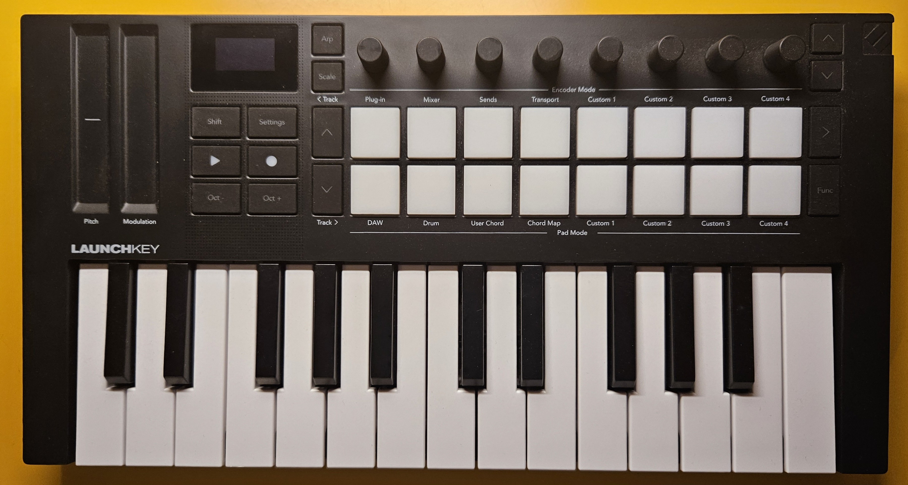
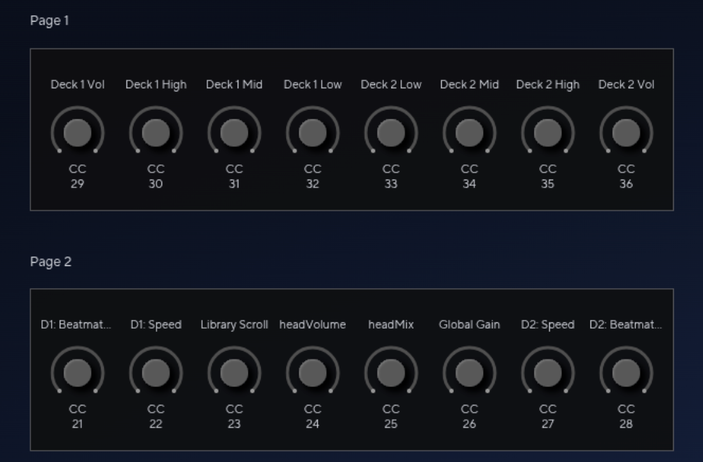
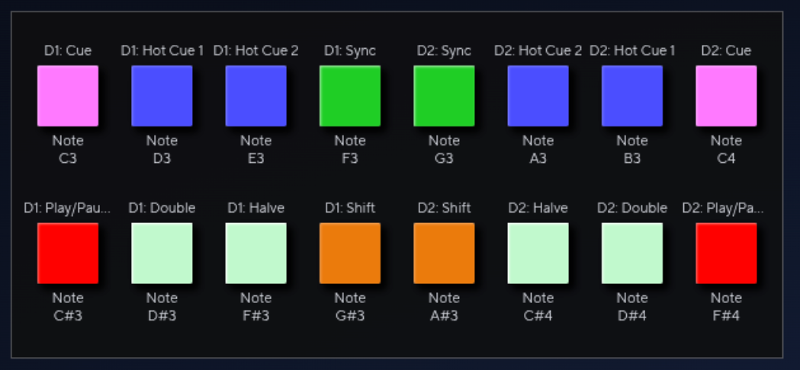

(novation_launchkey_mini_mk4_25)=

# Novation Launchkey Mini MK4 25

:::{sectionauthor} theotacconi <theotacconi@gmail.com>
:::

The Novation Launchkey Mini MK4 25 is a compact 25-key MIDI keyboard controller featuring velocity-sensitive pads, capacitive touch strips, and endless rotary encoders.

- [Manufacturer’s product page](https://novationmusic.com/products/launchkey-mini-25-mk4)
- [Forum thread](https://mixxx.discourse.group/t/novation-launchkey-mini-mk4-25-mapping/34407)

:::{versionadded} 2.6
:::

## Setup & Novation Components

This mapping requires a Custom Mode profile loaded onto the controller using **Novation Components**. The pads and encoders are configured to send MIDI messages on **MIDI Channel 5**, while the touch strips use their default messages on **MIDI Channel 1**.

1. Download the custom SysEx profile files (`MixxxKnobs.syx` and `MixxxPads.syx`) attached to the [Mixxx Discourse forum thread](https://mixxx.discourse.group/t/novation-launchkey-mini-mk4-25-mapping/34407).
2. Connect your Launchkey Mini MK4 25 to your computer.
3. Open [Novation Components](https://components.novationmusic.com/) in a WebMIDI-compatible browser (e.g. Google Chrome or Brave).
4. Upload the downloaded `.syx` files to your device and assign them to **Custom Mode 1**.

## Controller Mapping

### Encoders (Knobs)

The 8 rotary encoders are split into two pages via Novation Components (both sending on MIDI Channel 5):

 

**Page 1 (Mixer & EQ):**

* **Deck 1 Vol (CC 29)**: Adjusts Deck 1 volume.
* **Deck 1 High (CC 30)**: Adjusts Deck 1 high EQ.
* **Deck 1 Mid (CC 31)**: Adjusts Deck 1 mid EQ.
* **Deck 1 Low (CC 32)**: Adjusts Deck 1 low EQ.
* **Deck 2 Low (CC 33)**: Adjusts Deck 2 low EQ.
* **Deck 2 Mid (CC 34)**: Adjusts Deck 2 mid EQ.
* **Deck 2 High (CC 35)**: Adjusts Deck 2 high EQ.
* **Deck 2 Vol (CC 36)**: Adjusts Deck 2 volume.

**Page 2 (Navigation, Pitch & Headphones):**

* **D1: Beatmatch (CC 21)**: Temporarily nudges the tempo of Deck 1 to align the beats: turn right to speed up, left to slow down. Each step applies the same small nudge, regardless of how fast the knob is turned.
* **D1: Speed (CC 22)**: Adjusts the Deck 1 pitch/tempo slider.
* **Library Scroll (CC 23)**: Moves the selection up and down in the track library, one track per step.
* **headVolume (CC 24)**: Adjusts the headphone volume.
* **headMix (CC 25)**: Adjusts the headphone mix between cue and main output.
* **Global Gain (CC 26)**: Adjusts the main output gain.
* **D2: Speed (CC 27)**: Adjusts the Deck 2 pitch/tempo slider.
* **D2: Beatmatch (CC 28)**: Temporarily nudges the tempo of Deck 2, same as D1: Beatmatch.

### Performance Pads

All performance pads send MIDI Note messages on **MIDI Channel 5**. The Deck 2 pads mirror the Deck 1 layout:

 

Each deck has its own **Shift** pad, which only modifies the pads of that deck. Pressing a Shift pad also selects its deck as the target of the Modulation Strip (see Touch Strips below).

**Top Row:**

* **D1: Cue (Note C3 / 0x3C)**: Cue button for Deck 1 (behavior follows the cue mode set in the Mixxx preferences).
* **D1: Hot Cue 1 (Note D3 / 0x3E)**: Sets Hot Cue 1 on Deck 1 if empty, otherwise jumps to it.
  * **Shift + D1**: Clears Hot Cue 1.
* **D1: Hot Cue 2 (Note E3 / 0x40)**: Sets Hot Cue 2 on Deck 1 if empty, otherwise jumps to it.
  * **Shift + D1**: Clears Hot Cue 2.
* **D1: Sync (Note F3 / 0x41)**: Toggles sync lock for Deck 1.
  * **Shift + D1**: Loads the selected track into Deck 1.
* **D2: Sync (Note G3 / 0x43)**: Toggles sync lock for Deck 2.
  * **Shift + D2**: Loads the selected track into Deck 2.
* **D2: Hot Cue 2 (Note A3 / 0x45)**: Sets Hot Cue 2 on Deck 2 if empty, otherwise jumps to it.
  * **Shift + D2**: Clears Hot Cue 2.
* **D2: Hot Cue 1 (Note B3 / 0x47)**: Sets Hot Cue 1 on Deck 2 if empty, otherwise jumps to it.
  * **Shift + D2**: Clears Hot Cue 1.
* **D2: Cue (Note C4 / 0x48)**: Cue button for Deck 2 (behavior follows the cue mode set in the Mixxx preferences).

**Bottom Row:**

* **D1: Play/Pause (Note C#3 / 0x3D)**: Toggles play/pause on Deck 1.
  * **Shift + D1**: While playing, pauses Deck 1 after one bar (4 beats at the current tempo), counted from the moment the pad is pressed. Pressing Play again before then pauses immediately.
* **D1: Double (Note D#3 / 0x3F)**: Doubles the active loop on Deck 1. If no loop is active, starts a 1-beat loop.
  * **Shift + D1**: Exits the active loop.
* **D1: Halve (Note F#3 / 0x42)**: Halves the active loop on Deck 1. If no loop is active, starts a 1-beat loop.
  * **Shift + D1**: Exits the active loop.
* **D1: Shift (Note G#3 / 0x44)**: Shift modifier for Deck 1.
* **D2: Shift (Note A#3 / 0x46)**: Shift modifier for Deck 2.
* **D2: Halve (Note C#4 / 0x49)**: Halves the active loop on Deck 2. If no loop is active, starts a 1-beat loop.
  * **Shift + D2**: Exits the active loop.
* **D2: Double (Note D#4 / 0x4B)**: Doubles the active loop on Deck 2. If no loop is active, starts a 1-beat loop.
  * **Shift + D2**: Exits the active loop.
* **D2: Play/Pause (Note F#4 / 0x4E)**: Toggles play/pause on Deck 2.
  * **Shift + D2**: While playing, pauses Deck 2 after one bar, same as Shift + D1.

### Touch Strips

* **Modulation Strip**: Works as a virtual scratch platter. It controls the deck whose Shift pad was pressed last (Deck 1 at startup).
  * Sliding the finger scratches the track. Releasing the finger while it is still moving fast lets the track spin on and slow down gradually, like a platter released with momentum.
  * The strip does not report when the finger is lifted, so the mapping treats any pause of more than 50 ms in the movement as a release: keeping the finger still on the strip ends the scratch and the deck resumes normal playback.
* **Pitch Strip**: Works as the crossfader.
  * To avoid sudden jumps, the strip only takes control after you touch it close to the current crossfader position; from there, slide the finger to move the crossfader.
  * When the finger is lifted, the strip springs back to the center, but the crossfader stays where it was left.
