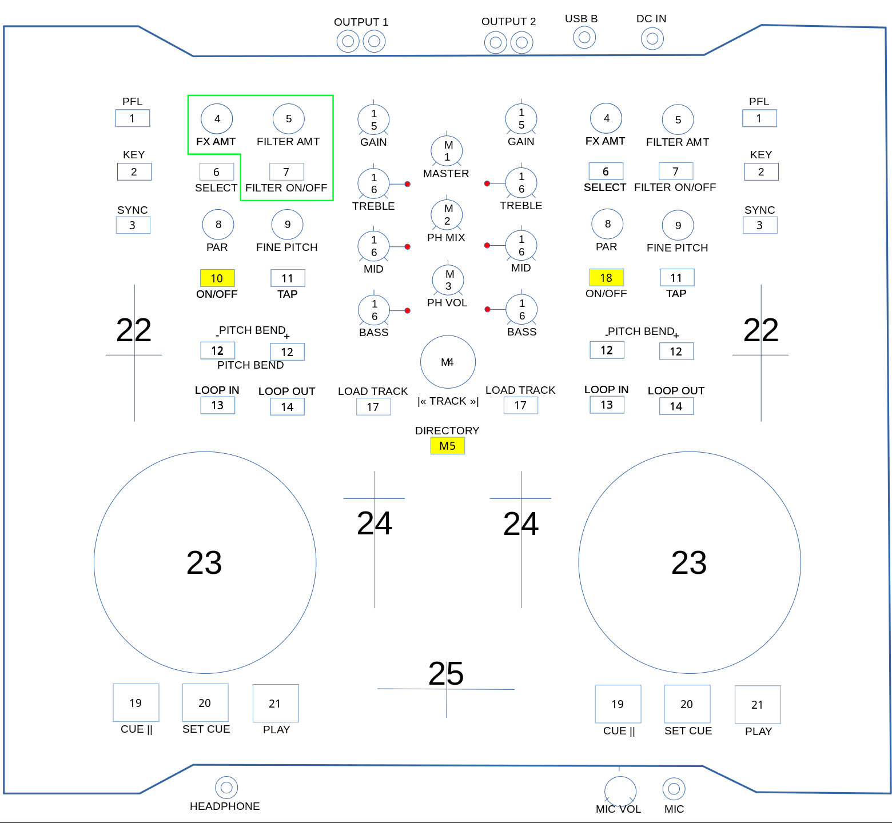

Numark Omni Control
===================

-  `Manfacturer’s product page <https://web.archive.org/web/20251116215741/https://www.numark.com/product/omnicontrol>`__
-  `Wiki page <https://github.com/mixxxdj/mixxx/wiki/Numark%20Omni%20Control>`__

.. versionadded:: 2.5.6

Description
===========

The Numark Omni Control is an 2 channel stereo DJ controller with integrated soundcard, 2 dual stereo outputs (RCA), 1 headphone output and 1 microphone input.
The device should be connected at least via USB 2.0 (USB-B plug) to use all of its features. Additional power supply (6 Volt, 1 Ampere) is usually not required.
This device is not `USB Audio Device Class <https://www.usb.org/document-library/usb-audio-devices-rev-30-and-adopters-agreement>`__ compliant and requires special drivers to work. 

Compatibility
=============

Official drivers
----------------

Latest official drivers can be found `here <https://web.archive.org/web/20251116224010/https://www.numark.com/product/omnicontrol>`__
-  Windows: 2.9.64 (still working with Windows 10 and 11)
-  Latest MacOS driver is still Intel-Architecture and is untested with ARM (aka M1 processors and later)
-  There is no official driver available for Linux.

Community drivers
-----------------

`Ozzy <https://github.com/mischa85/Ozzy>`__ is a reference implementation. Only use it at your own risk. 
It's is single-tested with MIXXX version 2.5.6 and feel free to add your experience for the community driver `here <https://github.com/mischa85/Ozzy/issues/95>`__ .
-  Windows 10: todo
-  MacOS: untested yet
-  Linux: Debian 6.12.113+deb13-amd64

Inputs and outputs of the audio interface
=========================================

TODO: It's highly recommended to reset all "hardware - soundcards" settings to "default" before, to avoid scattered sound samples.

Channel output
--------------

===================== ================
Output Channels       Assigned to
===================== ================
1-2                   Main
3-4                   Headphones
===================== ================

Microphone inputs
-----------------

Untested yet.

   Numark Omni Control (schematic view)

Controller Mapping in Normal Mode
=================================

MASTER
------

==== ================================================================================
 M1   Master volume
 M2   Headphone mix (cue to PGM)
 M3   Headphone volume
 M4   Trackselector (left/right = backward/forward) (press = play/pause prelistening)
==== ================================================================================

CHANNEL
-------

==== =======================================================================================
  1   PFL = Pre Fader Listening
  2   KEY = Keeps the key
  3   SYNC = one time synch of tempo (blinks at beat)
  6   SELECT = switchs loop anchor between start and end of loop (end of loop = light on)
  8   PAR = Beatjump; uses beatloop size (left/right = backward/forward)
  9   FINE PITCH = temporary change of the pitch even over min/max (resets at PITCH moving)
 11	  TAP = manual tap to calculate speed of the tracklist
 12   PITCH-BEND(-/+) = adjusting temporary deck play speed (-/+ = slower/faster) aka NUDGE
 13   LOOP IN = sets loop-in point
 14   LOOP OUT = sets loop-out point and reloop; keep pressed to disable reloop
 15   GAIN = adjusts gain of the channel
 16   EQ = (left/right = min/max) (press = push kill on/off) (light indicator = push kill)
 17	  LOAD TRACK = loads selected track into channel (if not playing)
 19   CUE = play deck from current cue point (cue is start if nothing else selected)
 20   SET CUE = sets new cue point
 21   PLAY = play/pause current deck
 22   PITCH = adjusting play speed of deck
 23   JOGWHEEL = adjusting temporary deck play speed (left/right = slower/faster)
 24   CHANNEL VOLUME 
 25   CROSS FADER
==== =======================================================================================

QuickEffect (green group)
^^^^^^^^^^^^^^^^^^^^^^^^^

==== ============================================================================
  4   FX AMT = rotate through QuickEffects (only if QuickEffect is not enabled)
  5   FILTER AMT = applies selected QuickEffect (only if QuickEffect is enabled)
  7   FILTER ON/OFF = QuickEffect (enabled = light on)
==== ============================================================================

Custom Mode switches (yellow)
^^^^^^^^^^^^^^^^^^^^^^^^^^^^^

==== ===================
 M5   Directory Mode 
 10   Scratch Mode 
 18   ExtendedLoop Mode
==== ===================

Custom Modes
============

Directory Mode 
--------------

This mode is enabled, if you press the "DIRECTORY" button or manually move to the folder in the MIXXX UI. The activation is shown by LED.

==== =========================================================================
 M4   Trackselector (left/right = up/down) (press = right aka open subfolder)
==== =========================================================================

Scratch Mode
------------

==== ====================================================
 23   JOGWHEEL = scratch (left/right = backward/forward)
==== ====================================================

ExtendedLoop Mode
-----------------

This mode also enables quantisation, so the LOOP IN and LOOP OUT are aligned at the beat grid.

===== ============================================================================================================
  8*   PAR = moves loop block* (left/right = backward/forward)
 12    PITCH-BEND(-/+) = changes size of the loop (-/+ = half/double), but keeps anchor (see: button 6 aka SELECT)
 13    LOOP IN = sets loop-in point and removes LOOP OUT point; disables reloop
 14    LOOP OUT = sets loop-out point and reloop; keep pressed to disable reloop while reaching the end of loop
 20    SET CUE = sets new cue point at the closest beat grid (because of quantisation)
===== ============================================================================================================

* = this is standard behavior of MIXXX

User customisations
===================

Edit the controller setup settings to customise the behavior.

Autostart
---------

Enables the following setting from start of MIXXX. Recommended settings enabled by default.

=================== =======================	==============================================
 Setting			 Buttons (if any)		 Description
 'Scratch-Mode'		 left channel: ON/OFF	 Custom mode is enabled from start (see above)
 'Extended Looping'	 right channel: ON/OFF	 Custom mode is enabled from start (see above)
 QuickEffects		 5 (left), 0 (right)	 QuickEffects of the left and right channel. 
 SoftTakeover		 (none)					 see `public documentation <https://github.com/mixxxdj/mixxx/wiki/Midi-Scripting#soft-takeover>`__
=================== =======================	==============================================

FinePitch and JogWheel Adjustment
---------------------------------

====================== ========= ========= =======================================================================================================================================
 Setting                Range     Default   Description
 FinePitchAdjustment    1-20(*)      9.00   FINE PITCH: the higher the value, the smaller the impact by FINE PITCH rotation. The value of '6' means same behavior as rate sliders.
 JogScratchAdjustment   1-5(*)       3.00   JOGWHEEL (in Scratch-Mode): the higher the value, the lower the impact on JOGWHEEL rotation)
 JogMoveAdjustment      1-20         3.00   JOGWHEEL (not in Scratch-Mode): the higher the value, the higher the impact by JOGWHEEL rotation
====================== ========= ========= =======================================================================================================================================

* = Exponential impact; small changes recommended.

Advanced
--------

=============================== =====================================================================================================================
 Setting              		    Description
 CUE doesn't stop playing deck  Pressing the CUE button while playing, doesn't stop the deck; if disabled, CUE button is in "CUP (Cue + Play) mode"
 only one PFL enabled at time	If PFL is enabled by pressing the button 1 (aka PFL) it disables the PFL on the opposite site.
=============================== =====================================================================================================================

Known Issues
============

-  After changing "audio latency time" the device needs be disconnected from USB. Restarting MIXXX won't be enough.
-  Right volume slider may be shown with wrong position after MIXXX programm start; just move the right volume slider once to re-adjust.