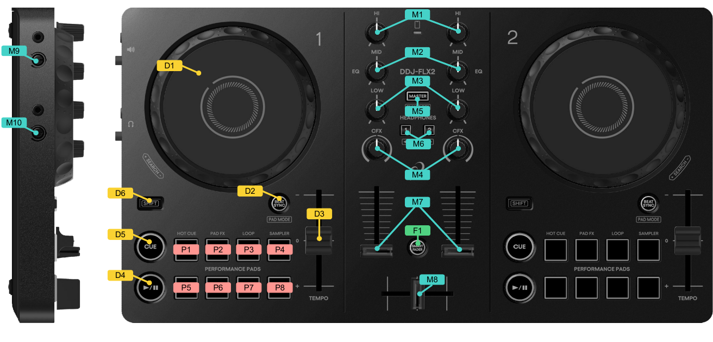

(pioneer-ddj-flx2)=

# Pioneer DDJ-FLX2


:::{sectionauthor} CupoMeridio
:::
```{figure-md}
:align: center



Pioneer DDJ-FLX2 (schematic view)
```
The Pioneer DDJ-FLX2 is an entry-level 2-deck DJ controller with a built-in USB audio interface. It features two capacitive jog wheels, 8 performance pads per deck, 3-band channel equalizers, dual-purpose CFX / Gain knobs, channel volume faders, a crossfader, and dedicated headphone cue buttons.

- [Manufacturer's Product Page](https://alphatheta.com/en/product/dj-controller/ddj-flx2/black/)
- [Manufacturer's Support & Help Center](https://support.alphatheta.com/en-US/products/32749270709529)
- [Manufacturer's Instruction Manual (PDF)](https://downloads.support.alphatheta.com/manuals/dj-controllers/DDJ-FLX2/DDJ-FLX2_DRI1917A_manual.pdf)
- [MIDI Message List (PDF)](https://downloads.support.alphatheta.com/software_info/dj-controllers/DDJ-FLX2/DDJ-FLX2_MIDI_Message_List_E1.pdf)
- [Mixxx Forum Thread](https://mixxx.discourse.group/t/ddj-flx2-mapping/31083)
- [Mixxx Pull Request #16567](https://github.com/mixxxdj/mixxx/pull/16567)

:::{versionadded} 2.6
:::
## Compatibility


The Pioneer DDJ-FLX2 is USB audio and MIDI class-compliant and works on Linux, Windows, and macOS without requiring proprietary drivers. On operating systems with Bluetooth Low Energy (BLE) MIDI support, the controller can also be connected wirelessly.

## Audio Setup


The controller includes a built-in stereo audio interface with a 3.5 mm master speaker output and a 3.5 mm stereo headphone output.

Configure Mixxx's {ref}`sound hardware settings <preferences-sound-hardware>` as follows:

| Output       | Channel |
| --- | --- |
| Master       | 1-2 |
| Headphones   | 3-4 |

:::{note}
The hardware volume knobs for Master output (M9) and Headphones output (M10) on the left side panel adjust the analog output level directly in hardware, but they also transmit MIDI messages. They are intentionally left unmapped: binding them to Mixxx's software master or headphone gain would change the level twice and upset the control's linearity.
:::
## Controller Mapping


A schematic drawing with the control numbers used below is shown in the diagram above.

### Deck section (D1 - D6)


| No. | Control | Function |
| --- | --- | --- |
| D1  | Jog Wheel (top surface) | Scratch (move playback position). |
| D1  | Jog Wheel (outer ring) | Pitch bend (temporary speed up / slow down). |
| D1  | {hwlabel}`SHIFT` + Jog Wheel (top surface) | Scroll library track list. |
| D1  | {hwlabel}`SHIFT` + Jog Wheel (outer ring) | Scroll library track list. |
| D2  | {hwlabel}`BEAT SYNC` button | Short press: Match tempo and phase of opposite deck (Beat Sync). Long press: Toggle Master Sync. |
| D2  | {hwlabel}`SHIFT` + {hwlabel}`BEAT SYNC` button | Cycle active Pad Mode (Hot Cue, Pad FX, Beat Loop, Sampler). |
| D3  | {hwlabel}`TEMPO` slider | Adjust playback tempo and pitch. |
| D4  | {hwlabel}`PLAY/PAUSE` button | Play or pause track. |
| D4  | {hwlabel}`SHIFT` + {hwlabel}`PLAY/PAUSE` button | Set the temporary cue point. |
| D5  | {hwlabel}`CUE` button | Set (while touching the platter) or jump to and play the temporary cue point. |
| D5  | {hwlabel}`SHIFT` + {hwlabel}`CUE` button | Jump to the cue point and stop playback. |
| D6  | {hwlabel}`SHIFT` button | Access secondary functions of hardware controls. |

### Mixer section (M1 - M8, F1)


| No. | Control | Function |
| --- | --- | --- |
| M1  | {hwlabel}`HI` EQ knob | Adjust high-frequency equalizer band (14-bit resolution, soft takeover). |
| M2  | {hwlabel}`MID` EQ knob | Adjust mid-frequency equalizer band (14-bit resolution, soft takeover). |
| M3  | {hwlabel}`LOW` EQ knob | Adjust low-frequency equalizer band (14-bit resolution, soft takeover). |
| M4  | {hwlabel}`CFX` knob | Normal: Adjust QuickEffect filter (14-bit resolution, soft takeover). {hwlabel}`SHIFT`: Adjust channel Pre-Gain (in Dual mode, 14-bit resolution, soft takeover). |
| M5  | {hwlabel}`HEADPHONES CUE (MASTER)` button | Toggle headphone Master monitor output. |
| M5  | {hwlabel}`SHIFT` + {hwlabel}`HEADPHONES CUE (MASTER)` | Toggle **4-Deck Mode** (switches physical decks between Decks 1/2 and Decks 3/4). |
| M6  | {hwlabel}`HEADPHONES CUE (CH 1 / CH 2)` buttons | Toggle headphone pre-fader listening (PFL) for corresponding channel. |
| M6  | {hwlabel}`SHIFT` + {hwlabel}`HEADPHONES CUE 1` | Short press: Load selected library track into active deck. Long press: Eject track from active deck. |
| M6  | {hwlabel}`SHIFT` + {hwlabel}`HEADPHONES CUE 2` | Cycle the effect in the first slot of the deck's Effect Unit (Deck 1 → Effect Unit 1, Deck 2 → Effect Unit 2). |
| M7  | Channel Faders | Adjust channel volume (soft takeover). |
| M8  | Crossfader | Blend audio output between left and right decks. |
| F1  | {hwlabel}`SMART FADER` button | Toggle software Fader Start: raising a channel fader starts its deck, lowering it to the minimum stops it. |

### Performance Pads (P1 - P8)


The 8 performance pads operate in four primary modes:

#### Hot Cue Mode (Pad Mode 1)

* **Pads 1 - 8**: Set (if empty) or jump to and play Hot Cue 1 - 8.
* **{hwlabel}`SHIFT` + Pads 1 - 8**: Delete Hot Cue 1 - 8.

#### Pad FX Mode (Pad Mode 2)

* **Pads 1 - 3**: Trigger effect slots 1, 2, and 3 in the deck's first Effect Unit (Effect Unit 1 for Deck 1, Effect Unit 2 for Deck 2). In the default *Override* setting, holding a pad temporarily enables the effect slot with 100% wet mix and the configured meta intensity; releasing the pad restores the previous effect parameters and enabled state. In *Toggle* mode, pressing a pad toggles the effect slot on or off without altering mix levels.
* **Pads 5 - 7**: Same as Pads 1 - 3, but address effect slots 1, 2, and 3 in the deck's second Effect Unit (Effect Unit 3 for Deck 1, Effect Unit 4 for Deck 2).
* **Pads 4 and 8**: No function.

#### Beat Loop Mode (Pad Mode 3)

* **Pads 1 - 8**: Trigger seamless beat loops with fixed lengths (1/8, 1/4, 1/2, 1, 2, 4, 8, and 16 beats).
* **{hwlabel}`SHIFT` + Pads 1 - 8**: Trigger loop rolls at corresponding divisions.

#### Sampler Mode (Pad Mode 4)

* **Pads 1 - 8 (Deck 1)**: Trigger Sampler slots 1 - 8.
* **Pads 1 - 8 (Deck 2)**: Trigger Sampler slots 9 - 16.
* **{hwlabel}`SHIFT` + Pads 1 - 8**: Stop sampler playback.

#### Optional Beat Jump Mode

Through user preferences, Pad Mode 4 (Sampler) or Pad Mode 2 (Pad FX) can be replaced with dedicated Beat Jump controls:

* **Pads 1 - 8**: Jump backward/forward in pairs of 1, 2, 4, and 8 beats.
* **{hwlabel}`SHIFT` + Pads 1 - 8**: Jump backward/forward by doubled intervals (2, 4, 8, and 16 beats).

## 4-Deck Layer Mode


Pressing {hwlabel}`SHIFT` + {hwlabel}`HEADPHONES CUE (MASTER)` (M5) toggles between **2-Deck Mode** (Decks 1 & 2) and **4-Deck Mode** (Decks 3 & 4):

* The physical left deck switches control between **Deck 1** and **Deck 3**.
* The physical right deck switches control between **Deck 2** and **Deck 4**.
* **Soft Takeover** is automatically engaged on Volume faders, Tempo sliders, EQ knobs, and CFX/Gain knobs to prevent audible jumps until physical controls catch up with target software positions.
* Active momentary Pad FX overrides are safely released when switching layers to prevent stuck effects.
* Deck button LEDs and loaded state indicators automatically update to reflect the newly active layer.

## Mapping Options


Custom settings for this controller can be configured in Mixxx under {menuselection}`Preferences --> Controllers --> Pioneer DDJ-FLX2`:

* **CFX Knob Behavior**:
  * *Dual (default)*: Turning the knob adjusts QuickEffect (Filter); holding {hwlabel}`SHIFT` adjusts channel Pre-Gain.
  * *Filter Only*: The knob only controls QuickEffect (Filter); holding Shift has no effect.
  * *Gain Only*: The knob only controls channel Pre-Gain; holding Shift has no effect.
* **Pad FX Behavior**:
  * *Override (default)*: Momentary hold enables effect slot at wet mix; releasing restores previous state.
  * *Toggle*: Each press toggles effect slot on/off without changing mix levels.
* **Pad FX Meta Value**:
  * Adjusts the parameter intensity applied during Pad FX Override mode (default: `0.75`).
* **Beat Jump Pad Mode**:
  * *Off (default)*: Standard manufacturer pad mode layout (Hot Cue, Pad FX, Beat Loop, Sampler).
  * *Replace Sampler (Pad Mode 4)*: Replaces Sampler mode with Beat Jump controls.
  * *Replace Pad FX (Pad Mode 2)*: Replaces Pad FX mode with Beat Jump controls.
