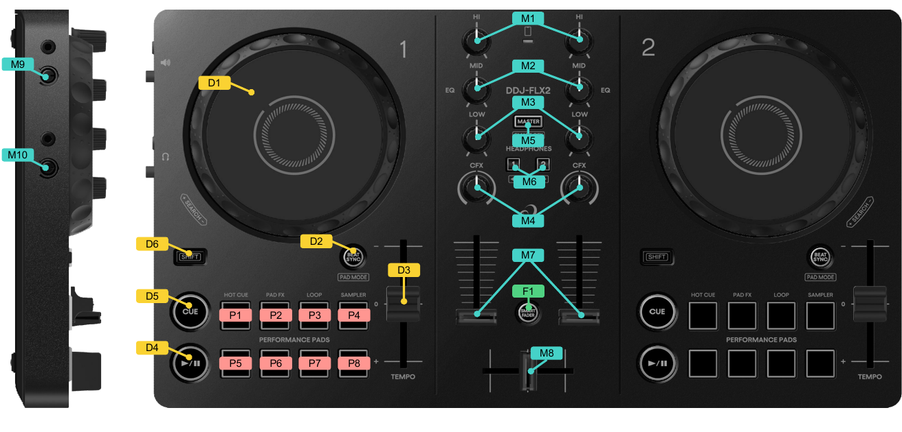

(pioneer-ddj-flx2)=

# Pioneer DDJ-FLX2


:::{sectionauthor} CupoMeridio
:::
```{figure-md}
:align: center



Pioneer DDJ-FLX2 (schematic view)
```
The Pioneer DDJ-FLX2 is an entry-level 2-deck DJ controller with a built-in USB audio interface. It features two capacitive jog wheels, 8 performance pads per deck, 3-band channel equalizers, dual-purpose CFX / Gain knobs, channel volume faders, a crossfader, and dedicated headphone cue buttons.

- [Manufacturer's Product Page](https://alphatheta.com/en/product/dj-controller/ddj-flx2/black/)
- [Manufacturer's Support & Help Center](https://support.alphatheta.com/en-US/products/32749270709529)
- [Manufacturer's Instruction Manual (PDF)](https://downloads.support.alphatheta.com/manuals/dj-controllers/DDJ-FLX2/DDJ-FLX2_DRI1917A_manual.pdf)
- [MIDI Message List (PDF)](https://downloads.support.alphatheta.com/software_info/dj-controllers/DDJ-FLX2/DDJ-FLX2_MIDI_Message_List_E1.pdf)
- [Mixxx Forum Thread](https://mixxx.discourse.group/t/ddj-flx2-mapping/31083)
- [Mixxx Pull Request #16567](https://github.com/mixxxdj/mixxx/pull/16567)

:::{versionadded} 2.6
:::
## Compatibility


The Pioneer DDJ-FLX2 is USB audio and MIDI class-compliant and works on Linux, Windows, and macOS without requiring proprietary drivers. On operating systems with Bluetooth Low Energy (BLE) MIDI support, the controller can also be connected wirelessly.

## Audio Setup


The controller includes a built-in stereo audio interface with a 3.5 mm master speaker output and a 3.5 mm stereo headphone output.

Configure Mixxx's {ref}`sound hardware settings <preferences-sound-hardware>` as follows:

| Output       | Channel |
| --- | --- |
| Master       | 1-2 |
| Headphones   | 3-4 |

:::{note}
The hardware volume knobs for Master output (M9) and Headphones output (M10) on the left side panel adjust the analog output level directly in hardware, but they also transmit MIDI messages. They are intentionally left unmapped: binding them to Mixxx's software master or headphone gain would change the level twice and upset the control's linearity.
:::
## Controller Mapping


A schematic drawing with the control numbers used below is shown in the diagram above.

### Deck section (D1 - D6)


| No. | Control | Function |
| --- | --- | --- |
| D1  | Jog Wheel (top surface) | Scratch (move playback position) while touching the platter. |
| D1  | Jog Wheel (outer ring) | Pitch bend (temporary speed up / slow down). |
| D1  | {hwlabel}`SHIFT` + Jog Wheel (top surface) | Scroll library track list (touching the platter with {hwlabel}`SHIFT` held does not stop the track). |
| D1  | {hwlabel}`SHIFT` + Jog Wheel (outer ring) | Scroll library track list. |
| D2  | {hwlabel}`BEAT SYNC` button | Short press: Match the tempo of the other deck once (Beat Sync; the phase is matched too when Quantize is enabled), or disable Sync Lock if it is enabled. Long press: Enable Sync Lock. |
| D2  | {hwlabel}`SHIFT` + {hwlabel}`BEAT SYNC` button | Pad Mode selection (Hot Cue, Pad FX, Beat Loop, Sampler), handled by the controller firmware. |
| D3  | {hwlabel}`TEMPO` slider | Adjust playback tempo (soft takeover). The on-screen slider always moves together with the hardware slider; whether moving it up increases or decreases speed follows the slider direction set in {menuselection}`Preferences --> Decks`. |
| D4  | {hwlabel}`PLAY/PAUSE` button | Play or pause track. |
| D4  | {hwlabel}`SHIFT` + {hwlabel}`PLAY/PAUSE` button | Set the cue point at the current position. |
| D5  | {hwlabel}`CUE` button | Behaves according to the {ref}`cue mode <interface-cue-modes>` selected in {menuselection}`Preferences --> Decks` (e.g. Mixxx, Pioneer, Denon), including cue preview while held. The button LED follows the selected cue mode as well. |
| D5  | {hwlabel}`SHIFT` + {hwlabel}`CUE` button | Jump to the cue point and stop playback. |
| D6  | {hwlabel}`SHIFT` button | Access secondary functions of hardware controls. |

### Mixer section (M1 - M8, F1)


| No. | Control | Function |
| --- | --- | --- |
| M1  | {hwlabel}`HI` EQ knob | Adjust high-frequency equalizer band (14-bit resolution, soft takeover). |
| M2  | {hwlabel}`MID` EQ knob | Adjust mid-frequency equalizer band (14-bit resolution, soft takeover). |
| M3  | {hwlabel}`LOW` EQ knob | Adjust low-frequency equalizer band (14-bit resolution, soft takeover). |
| M4  | {hwlabel}`CFX` knob | Normal: Adjust QuickEffect filter (14-bit resolution, soft takeover). {hwlabel}`SHIFT`: Adjust channel Pre-Gain with the same curve as the on-screen gain knob, from silence (fully left) through unity gain (center) to +12 dB (fully right) (in Dual mode, 14-bit resolution, soft takeover). |
| M5  | {hwlabel}`HEADPHONES CUE (MASTER)` button | Toggle the headphone mix between cue only and master only. The button LED is lit when the mix is on the master side, also when it is changed with the on-screen Cue/Mix knob. |
| M5  | {hwlabel}`SHIFT` + {hwlabel}`HEADPHONES CUE (MASTER)` | Toggle **4-Deck Mode** (switches physical decks between Decks 1/2 and Decks 3/4). |
| M6  | {hwlabel}`HEADPHONES CUE (CH 1 / CH 2)` buttons | Toggle headphone pre-fader listening (PFL) for corresponding channel. |
| M6  | {hwlabel}`SHIFT` + {hwlabel}`HEADPHONES CUE 1` | Short press: Load selected library track. Long press: Eject track. The target deck is the active deck of the side whose {hwlabel}`SHIFT` is held: left {hwlabel}`SHIFT` targets the left deck (Deck 1 or 3), right {hwlabel}`SHIFT` targets the right deck (Deck 2 or 4). |
| M6  | {hwlabel}`SHIFT` + {hwlabel}`HEADPHONES CUE 2` | Cycle the effect in slot 1 of Effect Unit 2, i.e. the effect triggered by Pad FX pad 1 on the right deck (in both deck layers). |
| M7  | Channel Faders | Adjust channel volume (14-bit resolution, soft takeover). The volume curve matches the on-screen channel fader. |
| M8  | Crossfader | Blend audio output between left and right decks. |
| F1  | {hwlabel}`SMART FADER` button | Toggle software Fader Start: raising a channel fader from the bottom starts its deck with Sync Lock enabled; lowering it to the bottom jumps to the cue point and stops the deck. |

:::{note}
Soft takeover is also active when the mapping starts: faders and knobs do not jump to their physical position. Move a control to (or past) its current on-screen value to take over.
:::

### Performance Pads (P1 - P8)


The 8 performance pads operate in four primary modes:

#### Hot Cue Mode (Pad Mode 1)

* **Pads 1 - 8**: Set (if empty) or jump to Hot Cue 1 - 8. While the deck is paused, holding a pad previews from the hot cue. Pad LEDs show which hot cues are set.
* **{hwlabel}`SHIFT` + Pads 1 - 8**: Delete Hot Cue 1 - 8.

#### Pad FX Mode (Pad Mode 2)

The effect units used by the pads depend on the physical deck side and stay the same in both deck layers.

* **Pads 1 - 3**: Trigger effect slots 1, 2, and 3 in the side's first Effect Unit (Effect Unit 1 for the left deck, Effect Unit 2 for the right deck). In the default *Override* setting, holding a pad temporarily routes the Effect Unit to the active deck only and enables the unit and the effect slot with 100% wet mix and the configured meta intensity; releasing the pad restores the previous routing, mix, meta value, and enabled states. In *Toggle* mode, pressing a pad only toggles the effect slot on or off: routing, unit enable, and mix are not changed, so the Effect Unit must already be enabled and assigned to the deck to hear the effect.
* **Pads 5 - 7**: Same as Pads 1 - 3, but address effect slots 1, 2, and 3 in the side's second Effect Unit (Effect Unit 3 for the left deck, Effect Unit 4 for the right deck).
* **Pads 4 and 8**: No function.

#### Beat Loop Mode (Pad Mode 3)

* **Pads 1 - 8**: Toggle beat loops with fixed lengths (1/8, 1/4, 1/2, 1, 2, 4, 8, and 16 beats). Pressing the pad of the active loop length disables the loop. The pad of the active loop length blinks, also for loops activated or resized from the Mixxx interface.
* **{hwlabel}`SHIFT` + Pads 1 - 8**: Trigger loop rolls at corresponding divisions while held.

#### Sampler Mode (Pad Mode 4)

* **Pads 1 - 8 (left deck)**: Trigger Sampler slots 1 - 8.
* **Pads 1 - 8 (right deck)**: Trigger Sampler slots 9 - 16.
* **{hwlabel}`SHIFT` + Pads 1 - 8**: Stop sampler playback.

Pad LEDs are off for empty samplers, lit for loaded samplers, and blink while a sampler is playing. Pads for sampler slots that are not available in the current Mixxx setup have no function.

#### Optional Beat Jump Mode

Through user preferences, Pad Mode 4 (Sampler) or Pad Mode 2 (Pad FX) can be replaced with dedicated Beat Jump controls:

* **Pads 1 - 8**: Jump backward/forward in pairs of 1, 2, 4, and 8 beats.
* **{hwlabel}`SHIFT` + Pads 1 - 8**: Jump backward/forward by doubled intervals (2, 4, 8, and 16 beats).

## 4-Deck Layer Mode


Pressing {hwlabel}`SHIFT` + {hwlabel}`HEADPHONES CUE (MASTER)` (M5) toggles between **2-Deck Mode** (Decks 1 & 2) and **4-Deck Mode** (Decks 3 & 4):

* The physical left deck switches control between **Deck 1** and **Deck 3**.
* The physical right deck switches control between **Deck 2** and **Deck 4**.
* **Soft Takeover** is automatically engaged on Volume faders, Tempo sliders, EQ knobs, and CFX/Gain knobs to prevent audible jumps until physical controls reach (or cross) the newly active deck's on-screen values.
* Active momentary Pad FX overrides are safely released when switching layers to prevent stuck effects.
* Actions held while switching layers (scratching, {hwlabel}`CUE` preview, hot cue preview, loop roll) are released on the deck where they started.
* Deck button LEDs and loaded state indicators automatically update to reflect the newly active layer.

## Mapping Options


Custom settings for this controller can be configured in Mixxx under {menuselection}`Preferences --> Controllers --> Pioneer DDJ-FLX2`:

* **CFX Knob Behavior**:
  * *Dual (default)*: Turning the knob adjusts QuickEffect (Filter); holding {hwlabel}`SHIFT` adjusts channel Pre-Gain.
  * *Filter Only*: The knob only controls QuickEffect (Filter); holding Shift has no effect.
  * *Gain Only*: The knob only controls channel Pre-Gain; holding Shift has no effect.
* **Pad FX Behavior**:
  * *Override (default)*: Momentary hold enables effect slot at wet mix; releasing restores previous state.
  * *Toggle*: Each press toggles effect slot on/off without changing mix levels.
* **Pad FX Meta Value**:
  * Adjusts the parameter intensity applied during Pad FX Override mode (default: `0.75`).
* **Beat Jump Pad Mode**:
  * *Off (default)*: Standard manufacturer pad mode layout (Hot Cue, Pad FX, Beat Loop, Sampler).
  * *Replace Sampler (Pad Mode 4)*: Replaces Sampler mode with Beat Jump controls.
  * *Replace Pad FX (Pad Mode 2)*: Replaces Pad FX mode with Beat Jump controls.
