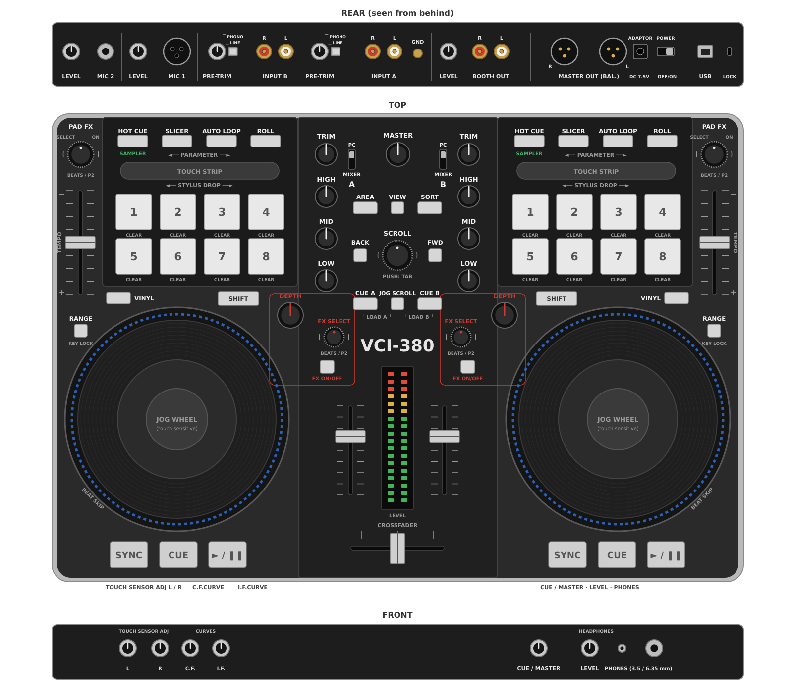

Vestax VCI-380
==============

The Vestax VCI-380 is a 2-deck controller with integrated audio interface and stand-alone mixer.
It requires its own external barrel plug power adapter (7.5 V DC, 1 A), and has a :hwlabel:`POWER` switch on the rear panel.

Outputs:

- :hwlabel:`MASTER OUT (BAL.)`: balanced XLR main output on the rear panel. Its volume is set by the :hwlabel:`MASTER` knob on the top panel.
- :hwlabel:`BOOTH OUT`: RCA booth output on the rear panel, with its own :hwlabel:`LEVEL` knob next to it.
- Headphones: 3.5 mm and 6.35 mm jacks on the front panel, with the :hwlabel:`CUE/MASTER` and :hwlabel:`LEVEL` knobs.

Inputs, on the rear panel:

- :hwlabel:`MIC 1` (XLR) and :hwlabel:`MIC 2` (6.35 mm jack), each with its own :hwlabel:`LEVEL` knob.
- :hwlabel:`INPUT A` and :hwlabel:`INPUT B` (RCA), each with a :hwlabel:`PRE-TRIM` knob and a :hwlabel:`PHONO` / :hwlabel:`LINE` button, and a :hwlabel:`GND` terminal for the turntable ground wire.

The audio interface only works at 48kHz: set :guilabel:`Sample Rate` to 48000 Hz in :menuselection:`Preferences --> Sound Hardware`.

As Vestax went out of business in 2014, there is no support for this hardware anymore. But as it is class compliant, no driver should be needed.

   Vestax VCI-380: rear panel (seen from behind), top panel and front panel

Useful links
------------

- `Wikipedia page about the defunct Vestax company <https://en.wikipedia.org/wiki/Vestax>`__
- `Archive of the product page <https://web.archive.org/web/http://www.vestax.com/v/products/detail.php?cate_id=189>`__
- `Mapping source and details on GitHub <https://github.com/jaymanu79/Vestax_VCI-380_Mixxx_Mapping>`__
- `Forum thread <https://mixxx.discourse.group/t/vestax-vci-380-mapping/14713>`__
- `Pull request for inclusion in Mixxx <https://github.com/mixxxdj/mixxx/pull/17089>`__
- `Old Mixxx wiki page <https://github.com/mixxxdj/mixxx/wiki/vestax_vci-380>`__

Audio Setup
-----------

The audio interface is set up in :menuselection:`Preferences --> Sound Hardware --> Output`.

========== ============== ============= ===================
Output     Device         Channel       Name in the device
========== ============== ============= ===================
Main       VESTAX VCI-380 Channel 1 - 2 Master Out L / R
Headphones VESTAX VCI-380 Channel 3 - 4 PFL Out L / R
========== ============== ============= ===================

Inputs - RCA (line/phono) and MIC - can be handled by the integrated mixer, so they don't need to be set up in Mixxx.
The audio interface also sends them to the computer, together with the controller's own master mix, so they can be used in :menuselection:`Preferences --> Sound Hardware --> Input`:

============= =================== ================================ ======================================================
Channel       Name in the device  Content                          Mixxx input
============= =================== ================================ ======================================================
Channel 1 - 2 Analogue In 1 L / R RCA input of the left channel    :guilabel:`Auxiliary 1` or :guilabel:`Vinyl Control 1`
Channel 3 - 4 Analogue In 2 L / R RCA input of the right channel   :guilabel:`Auxiliary 2` or :guilabel:`Vinyl Control 2`
Channel 5     Mic 1 In            microphone 1 (mono)              :guilabel:`Microphone 1`
Channel 6     Mic 2 In            microphone 2 (mono)              :guilabel:`Microphone 2`
Channel 7 - 8 Master Mix L / R    master mix of the controller     :guilabel:`Record/Broadcast`
============= =================== ================================ ======================================================

Each RCA input has a :hwlabel:`PHONO` / :hwlabel:`LINE` push button. Released (:hwlabel:`PHONO`), it switches on the turntable preamplifier; pressed (:hwlabel:`LINE`), the input takes a line level source (CD player, media player...).
If a line level source sounds distorted, check that the button is pressed (:hwlabel:`LINE`): the phono preamplifier saturates with line levels.
The :hwlabel:`PRE-TRIM` knob next to each input sets its gain.

For instance, the RCA inputs can be used for vinyl control (see the :hwlabel:`PC` / :hwlabel:`MIXER` switch below), and the master mix for :guilabel:`Record/Broadcast`, to record the whole set including the external inputs and microphones mixed by the controller.

.. note::

   On Linux, the inputs may sound choppy: the controller only configures its clock when the computer explicitly sets the sample rate, which Linux skips because the rate already reads 48 kHz.
   The outputs are not affected.
   A script that fixes it, to run on demand, is available in the `mapping repository <https://github.com/jaymanu79/Vestax_VCI-380_Mixxx_Mapping/tree/main/linux-audio-fix>`__.

Integrated mixer and external inputs
~~~~~~~~~~~~~~~~~~~~~~~~~~~~~~~~~~~~

Each channel has a :hwlabel:`PC` / :hwlabel:`MIXER` switch. It decides whether the RCA input of the channel is heard through the controller's own mixer:

- :hwlabel:`MIXER`: the RCA input (turntable, CD player...) is mixed by the controller itself, with the channel's TRIM, EQ, volume slider and the crossfader, together with the sound coming from Mixxx.
- :hwlabel:`PC`: the RCA input is muted in the controller's mixer. It is still sent to the computer (see the input channels above), so Mixxx can use it.

The sound coming from Mixxx goes through in both positions, so the switch doesn't change anything to the mapping.

Use :hwlabel:`MIXER` to play an external source directly, like on a classic DJ mixer, for instance a turntable or a CD player alongside Mixxx.

Use :hwlabel:`PC` when Mixxx processes the input:

- **Vinyl control**: set the channel of the timecode turntable or CD player to :hwlabel:`PC`, otherwise the timecode signal is heard on the master output on top of the track played by Mixxx.
  Configure the input in :menuselection:`Preferences --> Sound Hardware --> Input` (:guilabel:`Vinyl Control 1` on :guilabel:`Channel 1 - 2` for the left input, :guilabel:`Vinyl Control 2` on :guilabel:`Channel 3 - 4` for the right one), and press :hwlabel:`PHONO` / :hwlabel:`LINE` according to the source.
- **Mixxx effects on an RCA input**: instead of the simple hardware filter of :hwlabel:`DEPTH` / :hwlabel:`FX ON/OFF`, the RCA input can go through Mixxx and its effects.
  In :menuselection:`Preferences --> Sound Hardware --> Input`, select :guilabel:`Auxiliary` for the input (see the table above).
  :hwlabel:`PC` then avoids hearing the source twice: once directly through the controller's mixer, and once with the effects through Mixxx.

The microphones are not affected by the :hwlabel:`PC` / :hwlabel:`MIXER` switches: the controller always mixes them into its outputs, with their :hwlabel:`LEVEL` knobs on the rear panel.
They can also be set as :guilabel:`Microphone` inputs in Mixxx, but they are then heard twice (directly, and through Mixxx), so Mixxx effects on the microphones are not practical with this controller.

Some knobs act on the external inputs, in the controller's integrated mixer:

- :hwlabel:`TRIM` sets the gain of the external input. It also sets the gain of the Mixxx deck (see `Mixer functions`_).
- :hwlabel:`IF CURVE` (input fader curve) sets the curve of the volume sliders.
- :hwlabel:`CF CURVE` sets the curve of the crossfader. It also sets the Mixxx crossfader curve (see `Mixer functions`_).
- :hwlabel:`DEPTH` and :hwlabel:`FX ON/OFF` drive a high-pass filter on the external input. They also drive the Mixxx quick effect of the deck, so with a turntable on the input and a track playing in Mixxx on the same channel, both are affected.

Other knobs are handled by the controller itself, so they aren't mapped:

- :hwlabel:`MASTER` (top panel) sets the volume of the balanced XLR outputs only.
- :hwlabel:`LEVEL` next to :hwlabel:`BOOTH OUT` (rear panel) sets the volume of the booth output.
- :hwlabel:`PRE-TRIM` (rear panel) sets the gain of the RCA inputs, and the two :hwlabel:`LEVEL` knobs next to the microphone inputs set the microphone volumes.
- :hwlabel:`CUE/MASTER` (front panel) mixes the main output and the headphone cue (PFL / preview) in the headphones, and :hwlabel:`LEVEL` next to it sets the headphone volume.

The level meter in the middle of the top panel is driven by the controller too: it shows the master output, or the channels whose headphone cue is on.

Mapping
-------

Mixer functions
~~~~~~~~~~~~~~~

Main knobs and sliders work straightforwardly: :hwlabel:`TRIM` sets the gain of the deck, :hwlabel:`HIGH` / :hwlabel:`MID` / :hwlabel:`LOW` the EQ, and the volume sliders and crossfader the mix.

When the mapping starts, Mixxx takes the current position of every slider, knob and switch of the controller, so they're in sync from the start. The headphone cue buttons (:hwlabel:`CUE A` / :hwlabel:`CUE B`) toggle the headphone cue (PFL). The toggle is handled by the controller itself, and Mixxx follows its state.

Hold :hwlabel:`SHIFT` while turning EQ knobs (:hwlabel:`HIGH`/:hwlabel:`MID`/:hwlabel:`LOW`) for EQ kill mode: turning the EQ to the left side cuts the frequency range, turning to the right side re-enables it (all or nothing).

Hold :hwlabel:`SHIFT` while moving the crossfader to control output balance.

:hwlabel:`CF CURVE` sets the crossfader curve of Mixxx, from smooth transition (left) to sharp cut (right). It replaces the crossfader curve slider of :menuselection:`Preferences --> Mixer`.

Wheels
~~~~~~

You can turn the wheels with or without touching the sensitive metal part.
Make sure that the sensitivity is correctly set with :hwlabel:`TOUCH SENSOR ADJ` knobs on the front panel: the wheels must turn red when touched, and only then. If not, the tracks will refuse to play if Mixxx thinks that a platter is touched!

The LED rings are simulating a vinyl record spin.

====================================================== =================================
Action                                                 Effect
====================================================== =================================
Touch and turn wheels                                  scratching
Touch and turn wheels with :hwlabel:`SHIFT`            scratching at 10X speed
Turn wheels without touching                           temporary rate adjustments (jog)
Turn wheels without touching and with :hwlabel:`SHIFT` beatjump
Turn wheels with :hwlabel:`JOG SCROLL`                 library scrolling
====================================================== =================================

:hwlabel:`SYNC` / :hwlabel:`CUE` / :hwlabel:`> / ||`
~~~~~~~~~~~~~~~~~~~~~~~~~~~~~~~~~~~~~~~~~~~~~~~~~~~~

================================================== =======================================================
Key                                                Function
================================================== =======================================================
:hwlabel:`> / ||`                                  play/pause
:hwlabel:`SHIFT` + :hwlabel:`> / ||`               soft start / brake
:hwlabel:`CUE`                                     go to cue point
:hwlabel:`SHIFT` + :hwlabel:`CUE`                  set the cue point
:hwlabel:`SYNC`                                    blinks on each beat. Press to activate auto-sync.
:hwlabel:`SHIFT` + :hwlabel:`SYNC`                 adjust beatgrid position
:hwlabel:`VINYL`                                   toggle slip mode
================================================== =======================================================

"Tempo" sliders (pitch)
~~~~~~~~~~~~~~~~~~~~~~~

The sliders adjust pitch.

================================================== =================================
Action                                             Effect
================================================== =================================
:hwlabel:`SHIFT` + :hwlabel:`RANGE`                toggle keylock
:hwlabel:`RANGE`                                   toggle quantization
================================================== =================================

While the pitch is different from zero, the red PAD FX LED will light up as a reminder that the deck is pitched.

Navigation area
~~~~~~~~~~~~~~~

Library
^^^^^^^
============================================================== =================================================================
Action                                                         Effect
============================================================== =================================================================
Turn :hwlabel:`SCROLL`                                         move up/down
:hwlabel:`BACK` and :hwlabel:`FWD`                             move left/right
Turn left :hwlabel:`PAD FX`                                    move up/down (equivalent to turning SCROLL)
:hwlabel:`SHIFT` + turn left :hwlabel:`PAD FX`                 page up/down
Turn right :hwlabel:`PAD FX`                                   move left/right
:hwlabel:`SHIFT` + turn right :hwlabel:`PAD FX`                adjust waveform zoom
:hwlabel:`SHIFT` + push :hwlabel:`PAD FX`                      clone other deck
:hwlabel:`AREA` or push any :hwlabel:`PAD FX`                  default action
push :hwlabel:`SCROLL`                                         change focus zone (:hwlabel:`TAB`)
:hwlabel:`SORT`                                                sort according to active column
:hwlabel:`CUE A` / :hwlabel:`CUE B`                            toggle headphone cue (PFL) for deck A or B
:hwlabel:`JOG SCROLL` + :hwlabel:`CUE A` / :hwlabel:`CUE B`    load selected track into deck A or B
:hwlabel:`VIEW`                                                load and play selected track on preview deck. Push again to stop.
============================================================== =================================================================

End-of-track alerts
^^^^^^^^^^^^^^^^^^^

When a track is playing within the end-of-track warning time (set in :menuselection:`Preferences --> Waveforms --> End of track warning`), the library LEDs blink.

For deck 1: :hwlabel:`AREA` and :hwlabel:`BACK`

For deck 2: :hwlabel:`SORT` and :hwlabel:`FWD`

Quick Effects
~~~~~~~~~~~~~

For both decks:

================================================== ==============================================
Action                                             Effect
================================================== ==============================================
turn :hwlabel:`FX SELECT`                          select a quick effect preset
push :hwlabel:`FX SELECT`                          load the first quick effect preset of the list
:hwlabel:`FX ON/OFF`                               toggle quick effect ON/OFF
turn :hwlabel:`DEPTH`                              adjust the effect parameter ("superknob")
================================================== ==============================================

Performance pads and strips
~~~~~~~~~~~~~~~~~~~~~~~~~~~
Both strips are used in any mode for needle drop (quick navigate) on the preview deck.

To do a needle drop on the main decks, hold :hwlabel:`SHIFT` and touch the corresponding strip.

The pads work in different modes, according to the selection buttons on the top of the controller. The modes are not always related to the names they bear on the controller.

:hwlabel:`HOT CUE` mode: HOTCUES
^^^^^^^^^^^^^^^^^^^^^^^^^^^^^^^^
8 hot cues available, one per pad. The pads will light up when their hotcue is set.
The colors of the lights will approximate the colors defined for the hot cues.

- push a lighted pad to play the hotcue
- push a blank pad to set a new hotcue to the current position.
- push :hwlabel:`SHIFT` + lighted pad to clear a hotcue
- loop hotcues: the pad will turn green when the loop is active, push to disable loop

:hwlabel:`SLICER` mode: BEAT GRID tools
^^^^^^^^^^^^^^^^^^^^^^^^^^^^^^^^^^^^^^^
The 8 pads will illuminate in sequence following the beat grid. To reset the sequence to beat 1, push the :hwlabel:`SLICER` button again.

- Push a button of higher row: BPM tap. Tap it in rhythm to adjust the calculated BPM of the track
- Push a button of lower row: align beatgrid. Tap it to align the beatgrid bars to the current position.

:hwlabel:`AUTO LOOP`: loop mode
^^^^^^^^^^^^^^^^^^^^^^^^^^^^^^^
The green buttons on the left control loop activation.

- upper (button 1): creates or disables a loop (beatloop_activate)
- lower (button 5): reactivates existing loop (reloop_toggle)

The yellow buttons control beatloop size:

- left (button 3): halves the size
- right (button 4): doubles the size

The white buttons control the loop position:

- left (button 7): move left
- right (button 8): move right

Buttons 2 and 6 are unused.

:hwlabel:`ROLL`: Stems mode
^^^^^^^^^^^^^^^^^^^^^^^^^^^
If the loaded track has stems, the pads will light up in vertical pairs with the corresponding stem colors.
Stems 1 to 4, left to right:

- Push the lower button to mute/unmute the stem
- Hold the upper button (it will turn white) for FX control. While the button is pressed:

  - the quick effect buttons (FX Depth, FX select and FX on/off) apply to the selected stem instead of the whole track. (see: quick effects)
  - the parameter strip sets the individual volume of the selected stem

:hwlabel:`SAMPLER` mode (:hwlabel:`SHIFT` + :hwlabel:`HOT CUE`)
^^^^^^^^^^^^^^^^^^^^^^^^^^^^^^^^^^^^^^^^^^^^^^^^^^^^^^^^^^^^^^^
In Sampler mode, each pad is controlling one of the samplers.
They are mapped so the pads are organized in the same layout as the 8 samplers on Mixxx default skin.

====== ================= ==================== =============================
Color  Meaning           Pad action           :hwlabel:`SHIFT` + pad action
====== ================= ==================== =============================
dimmed no track loaded   load selected track
green  a track is loaded play                 eject
yellow playing           restart              stop
====== ================= ==================== =============================

Switching to sampler mode will automatically activate the samplers display on screen.

Customization
~~~~~~~~~~~~~

The colors used can be customized by editing the mapping JavaScript file.
Also the color pattern shown at startup on decks without a track can be modified to your liking.
